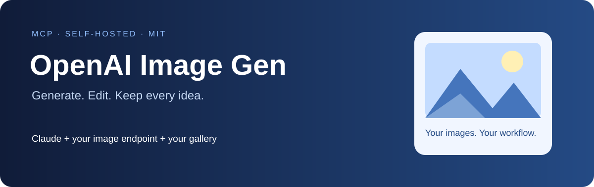
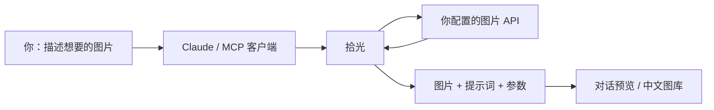
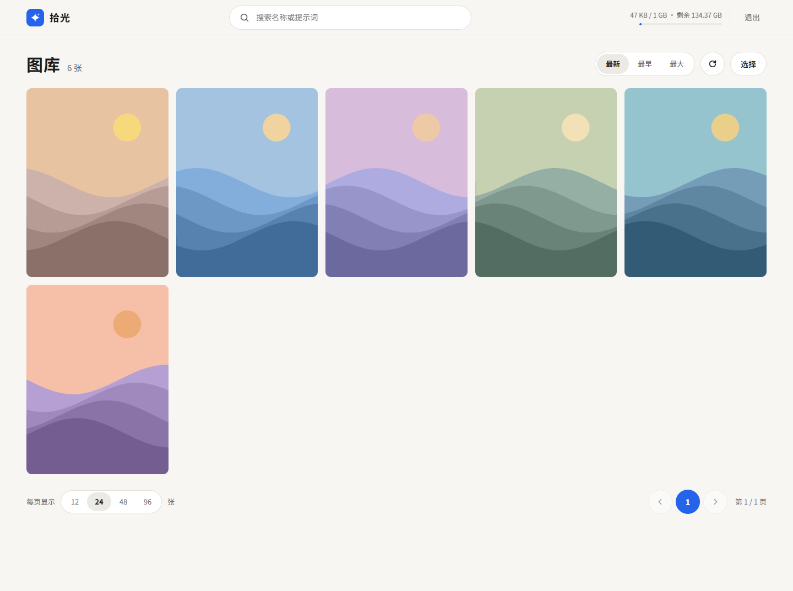
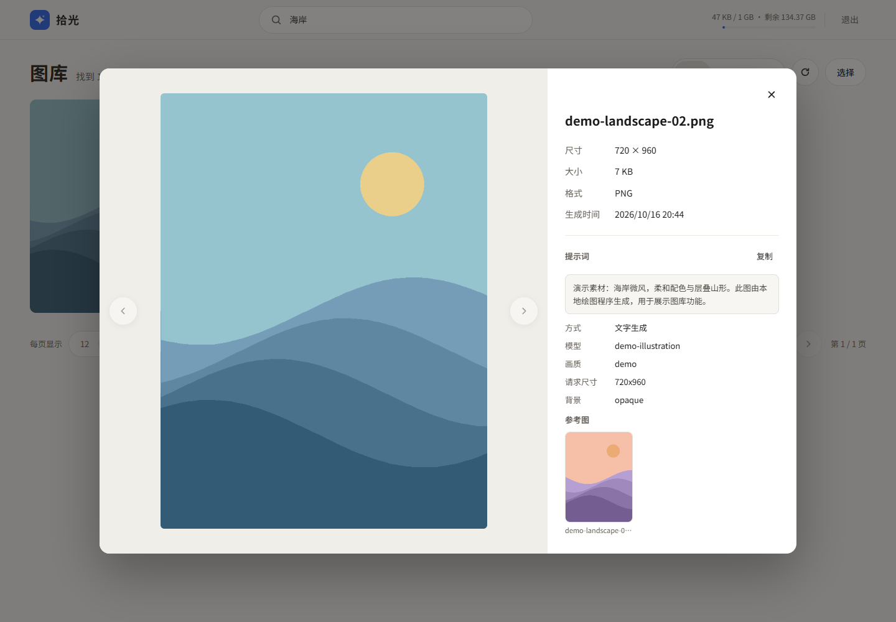
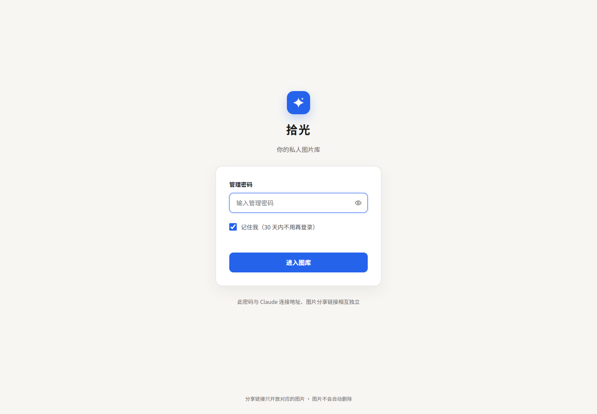
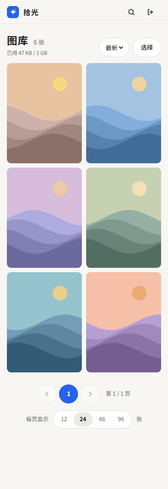

<p align="center"></p>

<p align="center">
  <a href="LICENSE"></a>
  
  
  
</p>

# 拾光

**让 Claude 帮你生成图片、参考图改图，并把提示词和作品一起保存。**

一个可自行部署的图片生成 MCP 服务，也可以作为 Claude Code 插件在本地运行。使用你自己的 API Key，连接 OpenAI 或兼容图片接口；远程部署附带中文图库管理网页。

[快速开始](#快速开始) · [图库体验](#图库体验) · [远程部署](DEPLOY.md) · [配置说明](#配置说明) · [测试](#测试)

## 30 秒了解

| 你想做什么 | 它能帮你做什么 |
| --- | --- |
| 为页面配图 | 生成插画、背景、图标、卡面，保存为可直接使用的图片文件 |
| 延续已有作品 | 使用一张或多张参考图改图，也支持遮罩输入 |
| 找回创作过程 | 保存提示词、参数和参考图关系；用 `image_info` 读取后再创作 |
| 管理作品 | 在网页预览、搜索、排序、下载、分享和删除图片 |
| 在不同设备使用 | 本地 stdio 接入，或通过 HTTPS MCP 接入远程客户端 |



> 项目提供调用和管理能力；生成质量、可用模型、参数支持与费用由你选择的 API 服务决定。本项目不是 OpenAI 官方产品。

## 图库体验

以下截图来自本地实际运行的管理系统。图片和提示词是专门制作的演示数据，不含私人图库内容；演示图片由本地绘图程序生成，不用于展示 AI 模型的生成质量。

**桌面图库**



**图片预览、提示词和参考图**



<details>
<summary>查看登录页与手机界面</summary>





</details>

- **查看图片与记录**：原图预览、提示词复制、模型与尺寸等参数、参考图跳转和返回。
- **快速定位**：按文件名或提示词搜索，按时间或体积排序，支持分页。
- **管理与分享**：下载原图、复制独立分享链接、勾选批量删除；删除参考图前显示引用提醒。
- **独立登录**：管理密码与 MCP 密钥分开，支持“记住我”，适配手机浏览。

历史图片没有保存过的提示词不会自动恢复。外部参考图会尽可能保存副本到图库；图库已有参考图直接记录关联。

## 快速开始

### 选择使用方式

| | 本地插件 | 远程服务 |
| --- | --- | --- |
| 适合 | Claude Code 本地创作 | claude.ai 网页 / 手机及兼容远程 MCP 的客户端 |
| 需要 | Python 3.10+、uv、API Key | Docker Compose、HTTPS 域名、API Key |
| 图片存放 | 本机目录 | 服务器持久化数据卷 |
| 操作入口 | Claude Code 对话 | MCP 对话 + `/admin` 中文图库 |

### 本地插件：配置 → 安装 → 开始创作

先安装 [uv](https://docs.astral.sh/uv/)。在 Claude Code 的 `~/.claude/settings.json` 中配置自己的环境变量（已有配置请合并）：

```json
{
  "env": {
    "OPENAI_API_KEY": "YOUR_API_KEY",
    "IMAGE_MODEL": "YOUR_IMAGE_MODEL",
    "IMAGE_OUTPUT_DIR": "assets/generated"
  }
}
```

`IMAGE_MODEL` 填所选服务实际支持的模型。使用兼容接口时，另加 `OPENAI_BASE_URL`，例如 `https://relay.example.com/v1`；使用官方接口时省略它。

在 Claude Code 中安装：

```text
/plugin marketplace add hui455/shiguang
/plugin install shiguang@shiguang
```

重启 Claude Code，然后试着说：

> 给我的天气应用生成一张柔和蓝色背景，横版，保存为 weather-hero。
>
> 用刚才那张做参考，改成日落配色。
>
> 查看 weather-hero 的提示词和生成参数。

仓库仍为私有时，安装需要当前 GitHub 账号具有仓库访问权限。

### 远程服务：部署到自己的服务器

```bash
git clone https://github.com/hui455/shiguang.git
cd shiguang
cp .env.example .env
# 编辑 .env：填写 API Key、模型、MCP_SECRET、PUBLIC_BASE_URL 和 DOMAIN
```

按 [部署指南](DEPLOY.md) 选择现有反向代理或内置 Caddy，启动并运行验证脚本。通过后，在 claude.ai 的自定义 connector 中添加：

```text
https://YOUR_DOMAIN/YOUR_MCP_SECRET/mcp
```

配置独立的 `IMAGE_ADMIN_PASSWORD` 后，访问 `https://YOUR_DOMAIN/admin` 管理图片。完整 MCP URL 相当于密码；单张图片分享链接只授权读取对应图片。

## 可用工具

| 工具 | 功能 |
| --- | --- |
| `generate_image` | 根据提示词生成图片 |
| `edit_image` | 使用参考图和可选遮罩编辑图片 |
| `list_images` | 列出图片、提示词摘要及参考图信息 |
| `image_info` | 查看某张图的完整创作记录 |
| `image_config` | 查看当前模型、接口及配置状态 |
| `set_image_config` | 持久修改默认模型、尺寸和画质 |

插件还包含 `ui-image-gen` Skill，帮助 Claude 根据界面图位组织尺寸、风格和参考图。

## 配置说明

| 环境变量 | 用途 |
| --- | --- |
| `OPENAI_API_KEY` | 你自己的图片 API Key，必填 |
| `OPENAI_BASE_URL` | 可选兼容接口地址；不填时使用官方接口 |
| `IMAGE_MODEL` | 接口实际支持的模型名；代码默认 `gpt-image-2.5-flare`，部署时请确认或覆盖 |
| `IMAGE_OUTPUT_DIR` | 本地图片目录，默认 `generated-images` |
| `IMAGE_DEFAULT_SIZE` / `IMAGE_DEFAULT_QUALITY` | 默认尺寸和画质，均为 `auto`；支持范围取决于模型 |
| `IMAGE_PREVIEW_MAX_PX` | 预览图最长边，默认 512，范围 128–2048 |
| `MCP_SECRET` / `PUBLIC_BASE_URL` | 远程连接密钥与服务公开地址 |
| `IMAGE_ADMIN_PASSWORD` | 远程图库独立密码，至少 16 字符 |

更多容量与代理选项见 [.env.example](.env.example)。默认图片容量上限 1 GiB、磁盘剩余空间下限 2 GiB；达到限制会拒绝新请求，不自动删除旧图。

通过 `set_image_config` 保存的配置优先于环境变量，并对该实例的客户端共享。每次调用也可单独覆盖模型、尺寸和画质。

## 测试

9 个测试文件覆盖认证、下载、容量限制、图库、配置、持久登录、缩略图、提示词和参考图记录。测试使用模拟 API 与临时图片，不产生真实生图费用。

```bash
docker compose build
for test in tests/test_*.py; do
  docker run --rm -i --network none --entrypoint python shiguang-image-gen - < "$test" || exit 1
done
```

上述镜像名对应默认目录名 `shiguang`；自定义 Compose 项目名时需调整镜像名。

## 数据与费用

图片和记录存储在自己的机器或服务器。生成时，提示词和参考图会发送给配置的图片 API。分享链接应只发送给预期的接收者；删除图片后对应链接失效。API 调用按服务商规则收费，建议设置消费额度。

## License

[MIT](LICENSE) © 2026 Shiguang Contributors.
